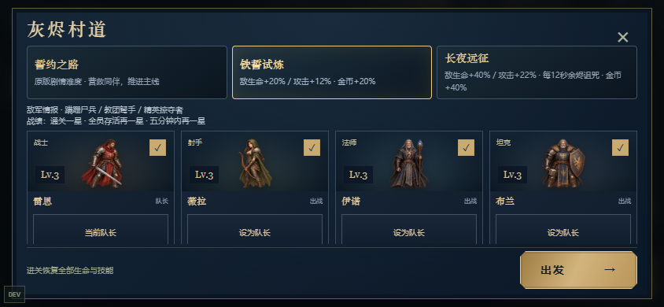

# 灰烬誓约 · 第一章十关可玩版（v0.13.0 移动Web发布候选）

暗黑奇幻的2D横向小队冒险。最多四人出战，点击地面移动、点击敌人锁定，点击头像切换当前角色。其他同伴自动作战。桌面鼠标与手机横屏触控共用一套游戏。

## v0.13.0：移动端发布候选

三种远征契约、星徽/最快用时、敌军图鉴、左右手技能布局、存档导入导出，以及首次联网准备后可离线开战的PWA。暗黑篝火主屏、第一章十关、五职业、装备与修习均可游玩。

仓库英文名：**2D fighting game**。本版为移动Web发布候选，尚未完成Android/iPhone真机性能、人工听感和应用商店审核；GitHub上传不等于已上架。

[审查与完成目标](docs/版本记录/v0.13.0_移动发布候选审查与改造.md) · [部署/离线/存档说明](docs/发布与部署.md) · [本轮交接](docs/进度交接/2026-11-05_v0.13.0_移动发布候选交接.md) · [许可与署名](THIRD_PARTY_NOTICES.md)

```powershell
npm ci
npm test
npm run build
npm run preview
```

通过HTTP地址游玩，手机横屏；HTTPS根目录部署可启用PWA。新玩家先走剧情，已通关关卡可选择进阶契约；标题“进度管理”可手动转移设备。短横屏出发按钮固定可见，同伴区内部滚动。不要直接双击dist/index.html。



2026-11-06 发布前修订加入备份恢复，并改进畸形存档处理和安装反馈。详见[代码审查与修订](docs/版本记录/v0.13.0_发布前代码审查.md)。

[下载生产构建](https://github.com/lyx0415/2D-fighting-game/actions/runs/42162475734)。在 Actions 的 Artifacts 下载 ashen-oath-v0.13-web，解压后在该目录执行 `python -m http.server 4173`，浏览器访问 `http://127.0.0.1:4173`。

## 历史：v0.12.0 录音重制与篝火营地

声音主体改为许可明确的兵器/材质音源、男女真人战斗录音和自然环境；全部52基础cue更新，另20真人选段变体。限制重复发力与叫痛、减少远处声与持续层响度，提供相同平均电平的30秒新旧试听。

主菜单使用原创篝火骑士大图与纵向菜单；营地以战役舆图为主，左侧直切四入口，右下启程。旧进度兼容，制作致谢与全屏入口可访问。

[新旧声音对照与新版主屏](素材库/原声与营地v012.html) · [版本记录](docs/版本记录/v0.12.0_录音重制与单机营地主屏.md) · [最新交接](docs/进度交接/2026-11-04_v0.12.0_录音与主屏交接.md)。双击启动游戏.cmd重建游玩。

## 历史：v0.11.0 可选声景与分层特效

三套音色：沉稳写实 / 粗砺战吼 / 秘仪回响，共72个新候选。设置可切换、试听并独立关闭发力声；新发力声去掉SAPI朗读层，仍为合成声音。护盾/守护持续声随实际状态收放。

仓库新增搜索、排序、弹出筛选与集中方格；成长页直接加点。五职业分层技能、Boss法阵/冲击/体型与生命增强，英雄和普通小兵进一步缩小。旧存档兼容。

[音色对比与实际画面](素材库/声景与整备v011.html) · [版本记录](docs/版本记录/v0.11.0_可选声景分层特效与紧凑整备.md) · [v011历史交接](docs/进度交接/2026-10-31_v0.11.0_声景特效与整备交接.md)。双击启动游戏.cmd重新构建游玩；营地右上齿轮切换声音方案。

## 历史：v0.10.0 修习与战斗展示

普攻显著降低音量；重做技能破空/命中层，新增五职业合成发力。人物再缩小约15%，建筑背景和独立石道路面分层。营地开放天赋点与技能升级，旧档按等级提供可分配点，免费重置。

[本次版本记录](docs/版本记录/v0.10.0_修习系统与战斗展示.md) · [v010素材对照](素材库/修习与战斗v010.html) · [v010历史交接](docs/进度交接/2026-10-31_v0.10.0_修习与战斗展示交接.md)。双击启动游戏.cmd重新构建后开始；已有存档无需重建。

## 历史：v0.9.0 展示与声景

人物约缩小四分之一，路面与路外明暗/石屑边界区分，地面和镜头同步；新增正面及不同四分之三待战图。攻击/技能/受击按职业区分，加入营地与五场景环境循环。出战时播放至少约1秒的章节信息与真实加载进度，期间暂停战斗，失焦后等玩家继续。

[v009素材与音效对照](素材库/展示与声景v009.html) · [版本记录](docs/版本记录/v0.9.0_地面展示多向姿态与声景.md) · [v009历史交接](docs/进度交接/2026-10-31_v0.9.0_地面姿态与声音交接.md)。日常游玩不需要图像或声音生成工具；重建素材才需要Python及NumPy/SciPy/Pillow。声音使用已保留源码许可的jsfxr离线层与原创DSP，本地WAV播放。

## v0.8.0 绘制美术

本版已改用内置GPT Images生成并本地打包的人物和环境：五英雄绘制动作、同画风敌人、五类战斗场景、独立路边物件与章节全景。移除重复方砖路覆盖，保留移动范围与技能预警。详见[绘制美术记录](docs/版本记录/v0.8.0_生成绘画与场景重制.md)、[本轮交接](docs/进度交接/2026-10-31_v0.8.0_绘制美术与场景交接.md)和[新图鉴](素材库/绘制美术v008.html)。此前矢量造型保留作历史。

## 开始游玩

Windows 上双击项目根目录的 **启动游戏.cmd**。脚本每次先构建最新源码，再打开生产预览：`http://localhost:4173/`。保持终端窗口运行，关闭窗口会停止服务。

若首次运行缺少依赖，启动脚本会执行 `npm ci`；依赖已经安装时不会重复安装。需要 Node.js 22.12+ 或24 LTS，当前项目在 Node.js 24.18.0 上验证。启动入口使用本机已有 PowerShell 7 路径。

手机连接与电脑相同的 Wi-Fi，在手机浏览器打开终端列出的局域网地址，例如 `http://电脑局域网IP:4173/`。不要在手机输入 `localhost`。若系统防火墙提示，需要允许本地开发服务器访问专用网络；项目不会自动修改防火墙。手机使用横屏。

开发命令：

```powershell
npm ci
npm run dev
npm test
npm run build
npm run preview -- --port 4173
```

开发默认端口5173，生产预览4173。浏览器存档按域名和端口隔离，因此不同端口的存档不共享。不能直接双击 `dist/index.html` 运行ES模块，应通过HTTP服务访问。

## 游玩内容

- 第一章10关、31个加长战区、60次前后遭遇、199名固定驻守敌人（Boss召唤物另计）：集结同伴 → 朝圣者旧道 → 修道院回廊与钟楼 → 地下墓道与祭坛 → 黑潮圣殿。
- 五职业：战士雷恩、射手薇拉、法师伊诺、坦克布兰、刺客赛芙。
- 第1关途中救下射手；第2关途中救下法师，通关救下坦克；第3关通关获得刺客。临时伙伴仅在通关后永久加入。
- 自动普通攻击、每人两个CD技能、AI跟随与躲避、精英攻击预警、据点典狱长和章节Boss黑潮主教。新增狂信徒、怨灵、脚下诅咒预警和主教召唤。
- 角色最高10级；武器、护甲、饰品三个槽位；白绿蓝三品质；金币强化到+3、换装和出售。
- 结算、首通奖励、重复挑战、五选四编队、本地存档及上一份有效备份。
- 五职业v006精细SVG：正面/四分之三默认脸、独立三角度头像、职业站姿与连续关节动作；宽幅等比舆图上10个疏朗连线节点与独立地标，最终Boss为大节点；蓝黑旧金中世纪骑士UI。
- 五英雄与十类敌人采用部位关节、肩肘/髋膝关联与职业动作；音效区分武器、十个技能与受击材质，配套斩击、冰霜、陨火、箭雨、护盾等程序特效。
- 远征地图为主屏，底部突出出发；战斗配置、装备仓库、英雄成长为次级整备面板。英雄成长中可分配天赋与技能点，营地免费重置。
- 装备工坊使用直接角色切换、集中方格仓库、部位/品质/穿戴状态/当前角色适用筛选和属性差值比较；右下角双技能使用各职业铭牌与大招徽印。
- 石道、金线与路缘明确可行走范围，路外点击不会移动；普通清节回复8%，Boss前余火休整回复35%。
- 原创SVG角色、分层场景和三张剧情插画；本地Web Audio合成音效，无外链图片、音频或字体。

操作：

| 行为 | 操作 |
|---|---|
| 移动/躲避 | 点击金线之间的石道；新命令替换此前追击 |
| 锁定/追击 | 点击敌人；接近后自动普攻 |
| 释放技能 | 点击右下角按钮；无目标不消耗CD |
| 切换角色 | 点击上方头像；角色CD不会重置 |
| 前进 | 清空战区后点击右方道路 |
| 装备与强化 | 主屏底部装备仓库 → 工坊，点角色头像和装备格 |
| 暂停 | 右上角Ⅱ；切后台、失焦或竖屏也会暂停 |

开始新游戏会提示覆盖原有进度。失败、放弃或战斗中刷新页面，不保留本次临时掉落及招募；此前进度不会损失。电脑和手机存档独立，不提供云同步。

## 开发与测试

核心模拟在 `src/core/`，不依赖Phaser；内容入口为 `src/core/data.ts`。画面与音效在 `src/game/`；页面在 `src/main.ts`；工坊在 `src/ui/workshop.ts`，职业技能样式在 `src/skill-hud.css`，工坊样式在 `src/workshop.css`。详细说明见 `docs/CONTENT.md`、`docs/BALANCE.md` 和 `docs/TEST_REPORT.md`。

开发环境左下角DEV提供新手、小队、成长三个隔离测试档、固定种子、范围与AI显示、清空当前波次。默认种子42，只影响测试档的新战斗。测试档与正式存档使用不同键；生产构建不包含DEV模块或全局测试桥接。

```powershell
npx playwright install chromium webkit
# 常规回归（含动作图鉴生成）
npm run test:e2e -- --grep-invert "新存档用真实鼠标输入"
# 含较慢的前三关实际鼠标流程
npm run test:e2e
# 可选：完整十关真实鼠标流程（较慢）
npm run test:chapter
```

Chromium项目默认使用本机Edge，WebKit使用Playwright运行时。浏览器自动化与手机尺寸模拟不能替代Android/iPhone真机验证。

## 版本边界

当前可从新档连续挑战第一章十关，保留五人招募、四人出战与营地成长循环。v0.6.0重绘立体宽幅地貌、放大四入口和重构五英雄多角度面容，存档兼容。v0.5.0升级连续关节和动作衔接、精细面部与敌人、差异音效特效及地图主屏，原存档兼容。v0.3.0将每节从1400加长至2200，增加后阵增援、显著提高小兵生命攻击，并重绘英雄、选关舆图和蓝黑旧金界面。等级上限仍为10级。旧版已通关第三关的存档会自动开放第四关，原角色、装备、金币保留；尚未通关第三关则不会跳关。

v0.3建立的数值基线在本轮继续使用；四种固定种子的纯模拟可不刷关打通十关，种子42模拟战斗约12分钟，第一关累计小队承伤约583点。15～25分钟的人类首玩目标、手机真机和FPS仍未验证。具体关卡与波次见[配置快照](docs/章节与数值快照.md)，实际测试范围见[验证报告](docs/TEST_REPORT.md)。

不包含后两章实际关卡、复杂天赋树、法宝、紫金红装备、联机、账号、云存档或商业发布。后续三章路线见 `docs/CONTENT.md`。

## 长期维护入口

完整设计、关卡分布和更新记录见[设计档案](docs/设计档案/00_总览与维护规则.md)，阶段状态见[交接索引](docs/进度交接/README.md)。统一素材见[素材库](素材库/README.md)和[素材图鉴](素材库/素材图鉴.html)。

本轮三项反馈与素材迭代详见[v0.6改版记录](docs/版本记录/v0.6.0_宽幅舆图与多角度面容.md)；较早五项优化与前后数值见[v0.3历史记录](docs/版本记录/v0.3.0_五项优化.md)。旧50项素材保存在素材库/99_历史版本/v0.2.0，禁止把旧资源当作当前运行版本。

本轮详细变更见[版本记录](docs/版本记录/v0.5.0_连续动作与远征主屏.md)，继续开发先读[最新交接](docs/进度交接/2026-10-30_v0.5.0_连续动作与远征主屏交接.md)。离线素材预览可打开[英雄姿态图鉴](artifacts/rig-v005-preview.html)，或运行 `npm run art:preview` 重新生成。

声音在支持Web Audio的浏览器首次点按后启用，可静音。当前Windows Playwright WebKit未提供Web Audio API；其音效验证需Safari真机补充，其他浏览器功能已独立检查。
